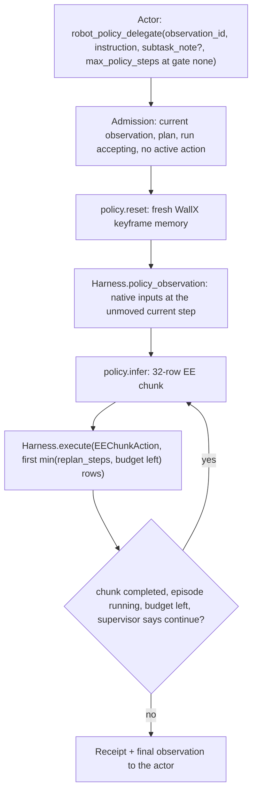

# Policy Delegation: Handing a Whole Subtask to WALL-OSS

The actor (GPT) remains the planner. When it judges that a subtask is worth handing over, it calls `robot_policy_delegate`; the Harness then runs the open vision-language-action policy WALL-OSS-1.0-lite (`x-square-robot/wall-oss-1.0-lite-robodojo`) closed-loop until the subtask ends and returns control with a compact receipt. Most tasks should not use it. The research target is the **gate**: deciding when delegation improves task performance and token efficiency. This document covers the mechanism, the prompt-level gate `pickplace_v9` with its camera supervisor, and the logging that makes the gate measurable. It is disabled by default (`features.wall_oss=false`).

This complements the $\pi_{0.5}$ bridge (`robot_policy_step`), which executes a short joint-space prefix for one local intent and returns after each prefix. Delegation instead runs many replans without consulting the actor, and the policy acts in its own native end-effector space. See [Embodied Harness Design §6](embodied-harness-design.md#6-role-of-action-models-and-local-controllers).

## Mechanism

1. **Admission** (nothing recorded or executed when it fails): `features.wall_oss` bridge present, the initial task plan exists, `observation_id` is the current observation, the run accepts actions and no action is active, at gate `none` `max_policy_steps` within `1..wall_oss.max_policy_steps` (at `pickplace_v9` the run fixes the budget and `instruction` is required). At gate `none` the instruction defaults to the native task instruction of the current observation; hashes are scrubbed before it reaches the policy.
2. **Reset** at every delegation start: the policy's episode state (keyframe memory, client RNG state) is fresh, and frames are numbered from 0 at the delegation start.
3. **Loop**: each inference returns the full chunk (32 rows); the first `min(replan_steps, steps left)` rows become one `EEChunkAction` executed through `Harness.execute`. Each chunk is an ordinary recorded action with its own request, receipt, progress events and terminal observation, so idempotency, the program gate, the native-step budget, stop requests and `unknown` handling all apply unchanged. The chunk returns the policy inputs for the next inference (see below).
4. **Stop conditions** (`stop_reason`): `max_policy_steps`; `monitor_done` / `monitor_takeover` (camera supervisor at `pickplace_v9`, see [Gate](#gate)); `episode_ended` (native terminal, success or step limit, deliberately not distinguished, exactly as other receipts report `episode_ended`); `native_budget_exhausted`; `policy_error` / `policy_timeout` (bridge or server failure; the client process is poisoned and reconnects at the next delegation); `policy_input_unavailable`; `safety_stop` (native IK failed for `wall_oss.ik_failure_stop_steps` consecutive steps); `chunk_rejected` / `chunk_failed` / `chunk_stopped` / `chunk_unknown` (owner reason in `stop_detail`); `cancelled` (run stopping).
5. **Receipt** (`kind="delegation"`, contract in `runtime/tools/output_contracts.py`): `status` (`finished`, `stopped`, `failed`, `rejected`, `unknown`), `stop_reason`, `stop_detail`, `policy_steps_used`, `max_policy_steps`, `replan_steps`, `inference_calls`, `chunk_action_ids`, `instruction`, `instruction_source`, `subtask_note`, `final_observation_id`, `ik_failed_steps`, `last_policy_action` (last executed row per arm: commanded `position_m`, `quaternion_wxyz` in `env_origin`, `gripper_command`), `action_budget` and, under the supervisor, `monitor` (checks, errors, verdict counts, supervisor tokens, last verdict). The final observation (images and measured state) follows in the same reply. The receipt never reports task success.

Arm scope is not a parameter: WALL-OSS always emits both arms, and RoboDojo's native EE interface requires both arms' keys in every action.

## End-Effector Chunk Execution (`EEChunkAction`)

Auriga's existing EE stack plans model-authored EE targets with cuRobo and executes resampled joint rows. Re-solving a learned policy's per-step EE targets through that planner would change its behaviour and claim an equivalence that was never measured, so policy chunks use a separate action type that executes the native format:

| Aspect | Implementation |
| --- | --- |
| RoboDojo interface | `eval_env.take_action(action)` with keys `left_ee_pose`, `right_ee_pose` (7 values each) and `left_ee_joint_state`, `right_ee_joint_state` (1 value each). The environment infers the `"ee"` action type from the `*_ee_pose` keys and calls `robot_manager.solve_ik(target_pose, env_idx, robot)` per arm, then interpolates the joint target over one native step (`collect_interval` physics ticks, 25 Hz for ARX X5). This is the same entry point the official XPolicyLab evaluation uses for `--action-type ee`. |
| Pose convention | `[x, y, z, qw, qx, qy, qz]`, position in metres, in the per-environment origin frame (`env_origin`) of the arm's `ee_link`, identical to the native observation state `*_ee_pose` (`robot_manager.get_real_endpose(..., is_relative=True)`). `pose_convention="xyz_qwxyz"`. |
| Gripper | Normalized opening command; the native interface clips it to `[0, 1]`. The receipt counts rows outside that interval (`gripper_commands_outside_unit_interval_rows`) instead of rewriting them. |
| Validation | `arx_contract.validate_ee_chunk`: both arms in every row, finite values, quaternion norm within `1e-3` of 1, every position coordinate within the same 2 m envelope applied to actor EE targets, 1..50 rows, `timeout_s` 0.1..300, policy provenance present, no speed or path options. |
| IK failure handling | Native behaviour is kept: an arm whose IK fails keeps its previous joint target. The worker records each arm's IK status from the same native call (no second solve) into `ee_chunk_ik`; `ik_failure_stop_steps` stops the chunk after that many consecutive failures of one arm and pauses with the usual stop confirmation. |
| Collision scope | `"native policy EE targets solved by native IK; no planner collision proof"`; there is no planner collision check, as for joint prefixes. |
| Provenance | `policy_provenance` names the generator (`wall-oss-1.0-lite-robodojo`), delegation, inference index and an observer-scope artifact with the full prediction. |

The worker module is [`robot/motion/ee_chunk_motion.py`](../../auriga/robot/motion/ee_chunk_motion.py); the adapter hooks are `RoboDojoAdapter._native_ee_action`, `native_policy_observation` and the read-only `policy_observation` worker operation.

## Policy Inputs and the Information Boundary

The official WallX loop records a head-camera frame at **every** simulator step and sends, at each replan, three-camera RGB plus EE state. During an `EEChunkAction` with `policy_capture=true` the worker reads the native observation after every executed row and keeps only the permitted fields: RGB colour of `cam_head`, `cam_left_wrist`, `cam_right_wrist`, each arm's `*_ee_pose` and `*_ee_joint_state`, and the public instruction. Depth, intrinsics and every other native field are ignored. The capture (head frames of the chunk plus the final three-camera RGB and EE state) is an uncompressed npz in the worker's private run directory. Harness hands it only to the policy bridge (`Harness.execute(..., policy_capture=list)`), never to the Store, a receipt, the actor or programs, and deletes it after the next inference. Lossless frames are sent, as in the official loop; the actor still sees the usual JPEG-archived observations.

The task id sent to WallX is the RoboDojo task name of the run (`run.task`), which the official loop also sends (`TASK_ENV.task_name`); WallX uses it to select its memory behaviour for the task family. The actor reply contains no evaluator state, no capture path, no server metadata and no memory internals.

## XPolicyLab Websocket Protocol and the WallX Adapter

The client [`policy_workers/xpolicylab_ws_client.py`](../../auriga/runtime/policy/policy_workers/xpolicylab_ws_client.py) runs in its own interpreter (`numpy`, `msgpack`, `websockets`), launched by [`runtime/policy/delegate_policy.py`](../../auriga/runtime/policy/delegate_policy.py) with a JSON-lines stdio channel; the Harness bounds every exchange and never resends.

Sources (XPolicyLab `6baccd5`, wall-x `39fa65b`, the serving commit the published WALL-OSS RoboDojo numbers use):

- Envelope and pairs: [`client_server/ws/protocol/schemas.py`](https://github.com/XPolicyLab/XPolicyLab/blob/6baccd57ff958570d0db1588370289ee36c8bb70/client_server/ws/protocol/schemas.py), [`messages.py`](https://github.com/XPolicyLab/XPolicyLab/blob/6baccd57ff958570d0db1588370289ee36c8bb70/client_server/ws/protocol/messages.py), [`codec.py`](https://github.com/XPolicyLab/XPolicyLab/blob/6baccd57ff958570d0db1588370289ee36c8bb70/client_server/ws/protocol/codec.py), [`client.py`](https://github.com/XPolicyLab/XPolicyLab/blob/6baccd57ff958570d0db1588370289ee36c8bb70/client_server/ws/protocol/client.py), [`model_client.py`](https://github.com/XPolicyLab/XPolicyLab/blob/6baccd57ff958570d0db1588370289ee36c8bb70/client_server/ws/model_client.py), [`model_server.py`](https://github.com/XPolicyLab/XPolicyLab/blob/6baccd57ff958570d0db1588370289ee36c8bb70/client_server/ws/model_server.py).
- Adapter: [`policy/WallX/model.py`](https://github.com/XPolicyLab/XPolicyLab/blob/6baccd57ff958570d0db1588370289ee36c8bb70/policy/WallX/model.py), [`deploy.py`](https://github.com/XPolicyLab/XPolicyLab/blob/6baccd57ff958570d0db1588370289ee36c8bb70/policy/WallX/deploy.py), [`memory_client.py`](https://github.com/XPolicyLab/XPolicyLab/blob/6baccd57ff958570d0db1588370289ee36c8bb70/policy/WallX/memory_client.py), [`deploy.yml`](https://github.com/XPolicyLab/XPolicyLab/blob/6baccd57ff958570d0db1588370289ee36c8bb70/policy/WallX/deploy.yml).
- Model side: [`wall_x/serving/robodojo/policy.py`](https://github.com/StarrickLiu/wall-x/blob/39fa65b9c9e95b0316db0fc9dbe41211e3a0d4cc/wall_x/serving/robodojo/policy.py), [`memory_policy.py`](https://github.com/StarrickLiu/wall-x/blob/39fa65b9c9e95b0316db0fc9dbe41211e3a0d4cc/wall_x/serving/robodojo/memory_policy.py), [`memory_protocol.py`](https://github.com/StarrickLiu/wall-x/blob/39fa65b9c9e95b0316db0fc9dbe41211e3a0d4cc/wall_x/serving/robodojo/memory_protocol.py).
- Native EE interface: RoboDojo [`src/eval_client/eval_env.py`](https://github.com/robodojo-benchmark/RoboDojo/blob/726e9aabfaa642203722eb126f5eaf0f37f3e1ad/src/eval_client/eval_env.py) (`get_action_type`, `take_action_batch`, `validate_action_dict`), `env/robot_manager/robot_manager.py` (`solve_ik`, `get_real_endpose`), `env/observation_manager/obs_manager.py` (`state` keys).

Wire format:

| Item | Detail |
| --- | --- |
| Frame | One binary websocket message per frame, a msgpack map: `message_type`, `message_id`, `evaluation_id`, `action_case_id`, `trial_id`, `repeat_index`, `step`, `sent_at`, `payload`. Responses echo `message_id`. No compression, unbounded `max_size`. |
| Arrays | msgpack-numpy maps `{nd, type, kind, shape, data}` (bytes keys); images are raw `uint8` HxWx3 arrays (the server's `decode_obs_images` passes decoded arrays through, so no JPEG colour-marker question arises). |
| Requests | `hello` -> `hello_ack {ok, server, server_instance_id}`; `reset {trial_id}` -> `reset_result {ok, result}`; `call {func_name, obs}` -> `call_result {ok, result, latency_ms}`; failures -> `error {code, message, details}`. |
| WallX reset | `result` is the initial client memory: `{version: 1, prev_sim_frame: null, mem_frame_ids: [], last_sel_frame: 0, consec_skip: 0, dump_count: 0, rng_state: bytes}`. |
| WallX infer | Must be `call` with `func_name="infer"` (the `infer` message type would route through `update_obs` + `get_action` and drop the returned memory). Observation: `vision.{cam_head,cam_left_wrist,cam_right_wrist}.color`, `state.{left,right}_ee_pose` (7, `xyz + wxyz`), `state.{left,right}_ee_joint_state` (1), `instruction`, `task_id`, `sim_frame`, `kfmem_client_state_v1` (`version`, `context_key`, `prev_sim_frame`, `ring`, `mem`, `mem_boxes`, `last_sel_frame`, `consec_skip`, `dump_count`, `rng_state`, optional `ring_sparse`) and `kfmem_history`. |
| WallX result | `{actions: [32 x {left_ee_pose[7], right_ee_pose[7], left_ee_joint_state[1], right_ee_joint_state[1]}], kfmem_state}`; absolute targets in the observation's frame; `kfmem_state` returns retained memory frame ids, counters, RNG state and a `ring_plan` after which only the frames the server reads are sent (`ring_sparse`). |
| Memory rules | First request: full ring `max(0, now-60)..now` and history `1..now` (here `now=0`). Later requests: advance at most the server's `replan_steps` (16) frames; memory ids strictly older than `now`. The client mirrors `memory_client.KFMemClientState`. |
| Control rate | One action row per native step at the RoboDojo `collect_freq` (25 Hz for ARX X5); 32 predicted, 16 executed per request. |

## Gate

Implemented in [`cortex/context/delegation_gate.py`](../../auriga/cortex/context/delegation_gate.py) and selected by `wall_oss.gate`. The gate is guidance, never a Harness rule: the actor decides from the tool description and the startup guidance, and nothing routes behind its back. Whenever `features.wall_oss` is on, the tool is loaded initially rather than deferred behind tool search, so its description is always in the actor's context.

- `none` (default): the tool description is the neutral mechanism text and there is no startup guidance. `instruction` is optional (the native task instruction is sent when it is omitted), and the actor chooses `max_policy_steps` (default `wall_oss.default_policy_steps`, at most `wall_oss.max_policy_steps`). No supervisor runs.
- `pickplace_v9`: object-level delegation with a budget fixed by the run and a camera supervisor, described below.

### `pickplace_v9`

**Tool text.** The description states only facts about the policy and the instruction format, with no concrete example and no benchmark task name (a test bans the object nouns of the benchmark instructions from the text, the guidance, the field help and the example):

- the policy runs closed-loop from the camera images and gripper poses, was trained on whole manipulation tasks given as one plain instruction like the native task instructions, does not read text, numbers or symbols, does no reasoning, and starts every call with empty memory;
- `instruction` (required) is one plain command in the style of the native task instruction: that instruction itself for the whole rest of the task when no decision is needed in between, otherwise the complete action on one object (or on the objects the task instruction handles together), naming the object and its destination by plain appearance and position; never one of several identical objects singled out by position, never a fragment (only a grasp, a single movement or a gripper command) and never a correction of an earlier result;
- a step whose rule violation fails the episode at once is done by the actor, which delegates at most its coarse object moves;
- after a failed call the same step may be re-issued once in the same wording; otherwise the actor finishes it itself;
- the stop sentence describes the supervisor and the budget (below), and the actor verifies every result itself (images, `geometry_query`) because the supervisor can be wrong about near misses.

The startup guidance repeats these rules in one paragraph; the `instruction` field help and a placeholder example match the text.

**Budget.** The actor does not choose a budget: `max_policy_steps` is not published and a supplied value is ignored. A call may use at most `wall_oss.call_budget_fraction` (default 0.8) of the episode's remaining native budget, bounded by `wall_oss.call_budget_max_steps` (default 2000), so a failed call leaves the actor a reserve to finish or correct the step.

**Supervisor.** [`runtime/policy/progress_monitor.py`](../../auriga/runtime/policy/progress_monitor.py) checks the call every `wall_oss.monitor_every_chunks` chunks (default 4 = 64 policy steps). One stateless OpenAI-compatible chat request (`monitor_model` at `monitor_base_url`, key read from `monitor_key_file`, never logged; separate from the actor's thread and token usage) sees the native task instruction, the delegated instruction and subtask note, the budget used and left, the head camera at the call start and at up to four earlier checks, and the three current cameras. It judges the progress over the whole sequence and answers:

- `done`: the sub-instruction is completed; the call ends with `stop_reason="monitor_done"`;
- `normal`: objects of the sub-instruction have reached their end state or are clearly getting there and the rest fits in the budget left; approaching, regrasping, short pauses, moving on to the next object, and one dropped object while the others progress are normal;
- `takeover`: progress is not as expected (the same attempt repeated, no object reaching or approaching its end state, an object lost while nothing else progresses, work on something else, or too slow for the budget left). After `wall_oss.monitor_takeover_consecutive` (default 1) takeover verdicts in a row the call ends with `stop_reason="monitor_takeover"`.

Both stops are `status="finished"`, and `stop_detail` carries the supervisor's reason. A check that errors or answers outside the schema counts as `normal` and resets the takeover streak; the supervisor never ends a call by failing. The configuration requires an http(s) `monitor_base_url` and a `monitor_key_file` when `features.wall_oss` is on at this gate.

Why a sequence question: a supervisor that only compares the head camera with the previous check keeps no memory, so a policy retrying the same failing attempt looks like progress at every check, and a pause between two objects of a good call looks like no progress. Replayed offline on 50 recorded calls (checks every 64 steps, one takeover verdict stops), the sequence question stopped none of 24 good calls and 17 of 21 calls that failed late, at a median of policy step 256 instead of 480.

## Logging for Gate Analysis

Every delegation writes, in the run store:

- record `policy_delegation_request/<delegation_id>`: the request, the public request (instruction and its source), policy identity, `task_id`, gate variant and the tool-call correlation (`thread_id`, `turn_id`, `tool_call_id`);
- record `policy_delegation_receipt/<delegation_id>`: the receipt returned to the actor;
- event `policy_delegation.started` (source `policy_delegation`): raw arguments, public request, gate, `task_id`, native budget and the actor token-usage snapshot (`runtime/token_usage`) at the call;
- event `policy_delegation.monitor` per supervisor check: verdict, confidence, reason, error, usage, latency, takeover streak, what the supervisor reports as completed and the steps of the head images it was shown;
- event `policy_delegation.finished`: receipt, per-inference details (frame, chunk length, executed rows, inference seconds, retained memory frame ids), per-chunk outcomes, client metadata, wall-clock duration, the token-usage snapshot at the end and `gate_log`, one compact record with the instruction, steps used, stop reason, per-arm and total IK failures, and `total_tokens_before` / `total_tokens_after`;
- state `runtime/policy_delegation`, copied into the episode `summary.json` as `policy_delegation`: gate, supervisor mode, number of delegations, native steps used by the policy and their budgets, IK failures, stop-reason counts, supervisor checks, errors, tokens and stops, and the compact per-call list (instruction, steps used and budget, stop reason and detail, tokens, supervisor summary).

During a delegation the actor makes no model requests, so the token cost of a delegation decision is measured offline by comparing the per-turn `token_usage` records around the call (keyed by `turn_id`) with the remaining episode, against the same task segments solved by direct control. The chunk actions, their receipts and the final observation are ordinary evidence for scoring and replay.

## Validation and Open Questions

CPU tests: [`tests/test_ee_chunk_action.py`](../../tests/test_ee_chunk_action.py) (contract and worker path on a native fixture), [`tests/test_xpolicylab_client.py`](../../tests/test_xpolicylab_client.py) (protocol round trip, codec compatibility with reference msgpack-numpy, memory rules, errors, timeouts and the stdio bridge against an in-process fake WallX server; skipped where `msgpack`, `msgpack_numpy` or `websockets` are absent) and [`tests/test_policy_delegation.py`](../../tests/test_policy_delegation.py) (loop, stop conditions, receipt contract, idempotency, logging, information boundary, tool gating, the `none` and `pickplace_v9` contracts, budget, supervisor loop and request, unchanged $\pi_{0.5}$ path). These verify the software contract only, not task performance.

To verify against a real WallX server and the native simulator before any claim:

- The native observation used by Auriga's worker must contain `state.*_ee_pose` and `state.*_ee_joint_state` (RoboDojo `world_ee_state` and `joint_states` robot config); a missing key fails the chunk with `native_observation_missing_policy_state`.
- EE frame: native `*_ee_pose` is the `ee_link` pose relative to the environment origin, which Auriga also reports as `env_origin`; confirm that `solve_ik(trans="world")` interprets the policy targets in the same frame in Auriga's environment construction.
- Control rate and interpolation: one native step per row at 25 Hz as in the official loop; confirm `collect_interval` is unchanged by Auriga's environment setup.
- Memory across delegations: each delegation resets the keyframe memory, unlike the official run where memory spans the episode from step 0. Memory-dependent tasks may need a delegation that starts at the task start, or a variant that keeps memory across delegations.
- Lossless frames versus the official pipeline: the official loop also sends raw `get_obs` arrays; confirm the server's `image_resize: serving` path is used.
- The server's `replan_steps` must be at least `wall_oss.replan_steps`; `trial_end` is not sent.
